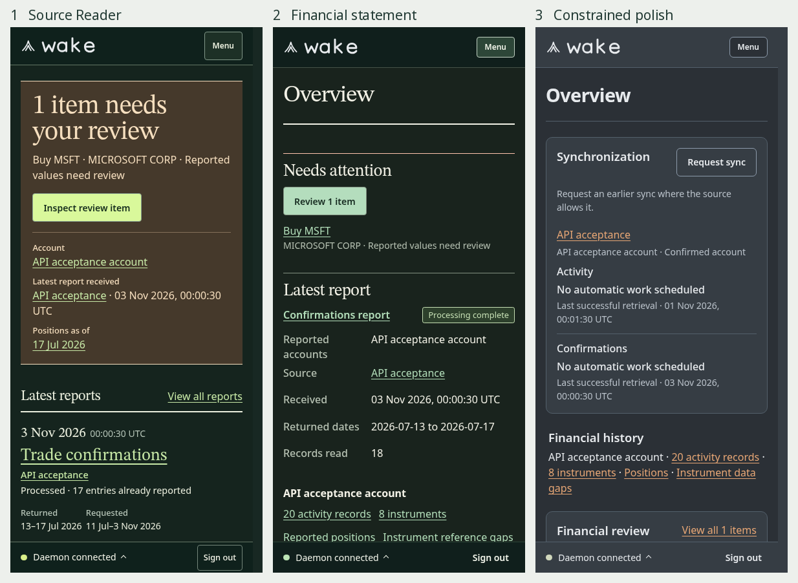
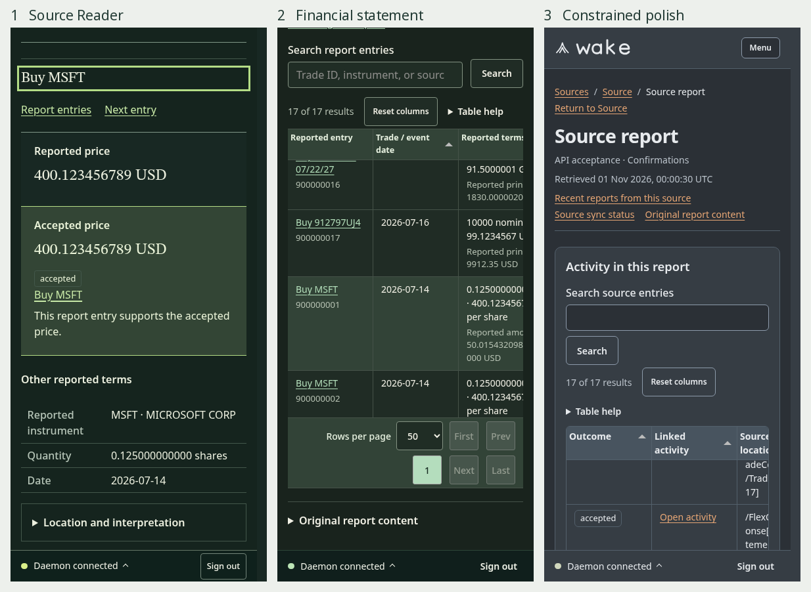
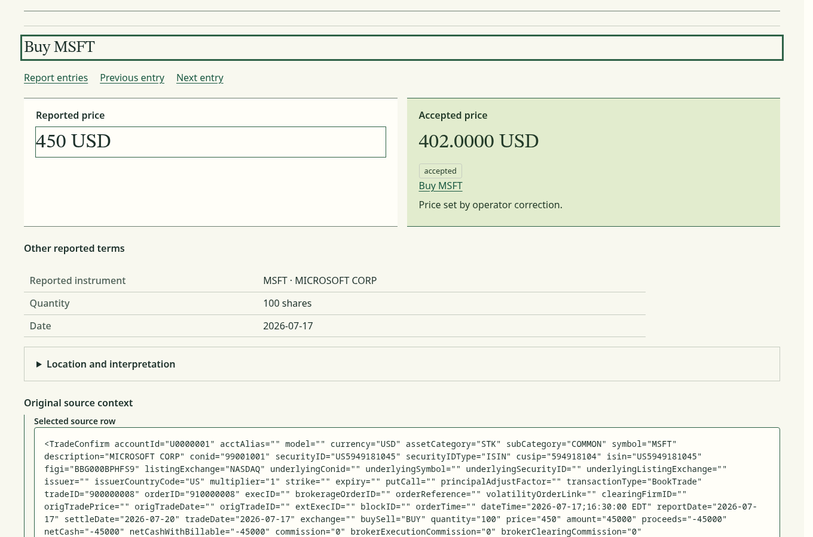
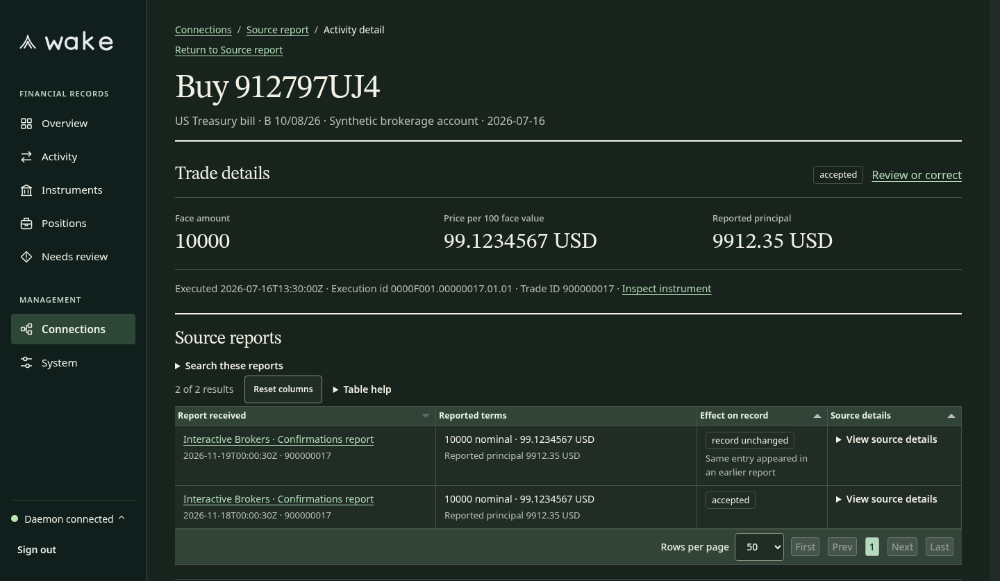
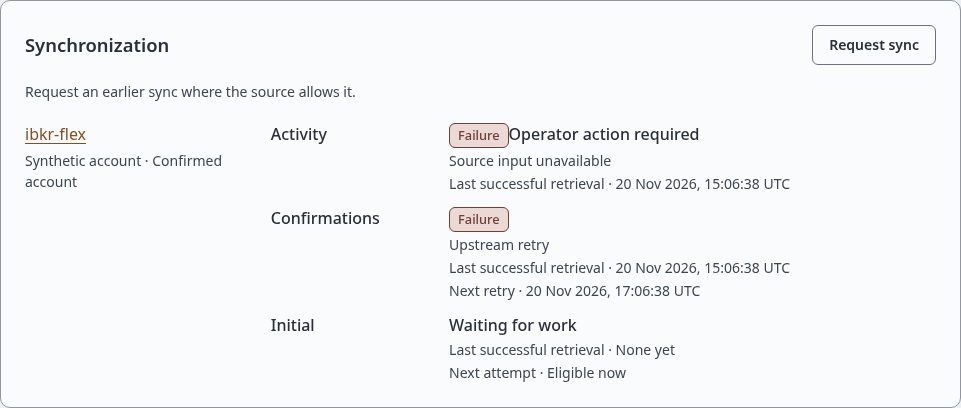

# Wake admin redesign contest

20 November 2026 · Design decision

**Choose Entry 1, Source Reader, as the foundation.** It gives Wake its clearest answer to
“Where did this number come from?” A reader can follow an exact price to the broker’s entry,
see what Wake accepted, and return to the same place. Borrow Entry 2’s compact Overview
and trade details, then use Entry 3’s language and per-stream status for synchronization.

## How the entries placed

| Place | Entry and assignment | Where it leads | What costs it ground |
| --- | --- | --- | --- |
| 1 | **Source Reader** · `9e09` · experimental redesign | Reading a report, distinguishing similar fills, and explaining a corrected price. | Sync status sits far down Overview. Report search misses visible report names. |
| 2 | **Financial statement** · `b7bb` · critique-led redesign | Daily Overview and trade details. Two confirmations lead to one Treasury bill, with each report’s effect visible on the trade. | On a phone, the report table separates the trade from its terms and effect. The report row omits the bill’s price basis. |
| 3 | **Constrained polish** · `f5eb` · refine the existing UI | Seeing which stream last succeeded, what happens next, and where to repair access. It keeps Wake’s familiar navigation and styling. | Repeated “Open activity” links make identifying a particular fill difficult. Browser Back lost keyboard focus in the shared test. |

I ranked the entries for a financially fluent operator. Explaining how a synced report became a
current record carried the most weight, followed by recognizing a problem on arrival and completing
the investigation on a phone or keyboard. Entry 3 met its narrower assignment well. It would be my
choice for a sync-only release.

## The same account, three opening screens

All three builds had one MSFT disagreement, a confirmation received on 3 November, and July
reporting dates. Source Reader immediately names the affected trade and separates the latest
receipt from the date of the positions. Its Synchronization heading starts **1,199 px** down
the desktop page. Entry 2 puts the review and latest report side by side, with Synchronization
at **471 px**. Entry 3 puts Synchronization at **147 px** and shows the last retrieval for
each stream. At 390 px wide, its Financial review heading begins **766 px** down an 844 px screen.

## The same fill, three ways to find it

The original confirmation contains two MSFT buys at **400.123456789 USD**. I opened the first,
broker trade **900000001**, from the report in each build. All three records preserved the full
price and the quantity **0.125000000000 shares**. The difference was what I could know *before*
opening the record, and what happened when I went back.

- **Source Reader** gave each fill a price and a distinct source ID. I could read the selected
  broker row beside the neighboring rows, open the record, then follow **View price source**
  back to the entry. The grid’s “Source ID” is the execution identifier. The broker trade ID
  appears in the original XML. Naming both would help someone working from a broker statement.
- **Financial statement** put the broker trade ID under **Buy MSFT** in the row itself. This was
  the fastest way to choose between the two buys when I already knew the ID. On the trade,
  **Source reports** explains what each appearance contributed. Back restored the record link.
- **Constrained polish** showed “Open activity”, the XML location, and a rule version. To select
  the same fill I had to know it was `TradeConfirm[1]`. Back reopened the report with focus on
  the document body at both tested widths. Give the link a trade name and ID, and restore focus
  to that link when the reader returns.

The mobile captures show the point immediately before opening the record. Entry 1 has an
intermediate reading view. Entries 2 and 3 open the record directly from the table.

## Taste visual critique

**Source Reader wins on visuals, followed by Financial statement and Constrained polish.**
Entry 2 has the best everyday Overview. I used
Taste’s redesign criteria for typography, color, spacing, visual hierarchy, and continuity with the
existing brand. For this interface the test is whether the composition helps someone read exact
financial evidence several times a day.

**1 · Source Reader.** The evergreen masthead leaves the width of a report available for reading.
STIX Two Text gives the two prices equal typographic weight, and the sage background and
“Accepted price” label distinguish Wake’s decision. On a phone the prices stack in reading order
with their full precision intact. The large tinted assessment at the top of Overview competes
with this strength. Give a quiet account a compact status line and reserve the larger treatment
for a decision with an immediate action. Keep the paired prices and ruled report pages.

**2 · Financial statement.** The deep-green rail, ivory page, serif headings, and thin rules give
the desktop trade the rhythm of a statement. Face amount, price per 100, and reported principal
each have a clear place across a single line. The same restraint works on Overview. On the narrow
report, however, the first columns consume the screen before the effect on the record appears.
Use two lines per mobile entry. Put the trade and its ID first, then the exact terms and effect.
Keep the full table on desktop.

**3 · Constrained polish.** The steel surfaces, copper links, and familiar wordmark preserve the
incumbent identity. The mixed-stream view makes good use of repeated alignment. An operator can
compare a failed request, an ordinary retry, and a healthy stream without learning a new layout.
Overview gives the bordered sync panel and its button most of the visual weight even when all
streams are idle. Keep its plain labels and alignment, move each repair beside its blocker, and
let the outstanding decision take the strongest emphasis. Move XML paths and rule versions into
an expandable row detail.

## What to carry into the next build

1. **Start with Entry 1’s report reader.** Keep Reports in primary navigation and preserve the
   selected report entry, original terms, current value, and return position. Fix report search
   first. Entering the displayed title “Trade confirmations” returned zero results in the matched
   build. Keep the two exact-price fills and the saved **450 USD → 402.0000 USD** correction as
   acceptance cases. Extend paired comparisons to other fields only where Wake can establish
   which source or decision supplied the value.
2. **Use Entry 2’s Overview composition and trade summary.** Lead with the affected record and
   the latest report, then show per-stream status. Keep the summary of both appearances of bill
   **900000017**. Show **10000 nominal**, **99.1234567 USD per 100**, and **9912.35 USD reported
   principal** on the report as well as the trade. The submitted report row drops “per 100”.
3. **Use Entry 3’s sync language and honest source links.** Show last successful retrieval,
   next attempt or retry, and a nearby repair action. Offer **Request sync** when it can advance
   work. Keep **Recent reports from this source** on Positions when Wake only knows the
   connection. Give a report awaiting processing its own message. A zero-row result currently
   produces “No activity entries in this report”, which can overstate what Wake knows.
4. **Validate the combined journey before adoption.** Use two like-priced fills, an overlapping
   report, an unlinked entry, a saved correction, and a source that cannot sync. Check the
   original terms, the accepted value, and keyboard focus on return at 390 px and 200% zoom.
   Time report opening and reverse lookup on a large synthetic history. Entry 1 still sends the
   whole retained report in its closed disclosure, and Entry 2’s reverse lookup scans retained
   appearances. The small fixtures establish behavior but give no production latency estimate.

I recommend **GPT-6.2 Sol with high reasoning** for the report-to-record
integration and **medium reasoning** for bounded layout, wording, and browser verification.

## Evidence and limits

The comparison used the three staged submissions on the same base, `37854bc`. I built each staged
tree in isolation and ran the same synthetic acquisition and source-conflict sequence. I used
Chromium through Playwright at **1360 × 900 light** and **390 × 844 dark**, with reduced motion
enabled. In all six cases I activated the record link by keyboard, inspected the same MSFT fill,
and used browser Back. The two comparison figures come from those runs.

The correction and Treasury bill figures come from the entrants’ synthetic walkthroughs. The
mixed-sync figure comes from a fresh Chromium fixture run. Focused Go checks passed for Entries 1
and 2, and focused Chromium checks passed for Entry 3. Entrant logs record full Go and Chromium
passes for Entries 1 and 2. Entry 3 completed Chromium and focused Go checks, and stopped its
full Go run before completion. Screen-reader use, operator preference, and performance on large
histories remain unmeasured.

Useful source locations in the respective staged worktrees include Entry 1’s
`internal/transport/admin/source_evidence.go` and
`internal/persistence/sqlite/sql/admin_queries.sql`,
Entry 2’s `internal/transport/admin/grids.go` and `readmodels.go` in the same directory, and
Entry 3’s `internal/transport/admin/workspaces.templ`, `grids.go`, and `assets/app.js`.
