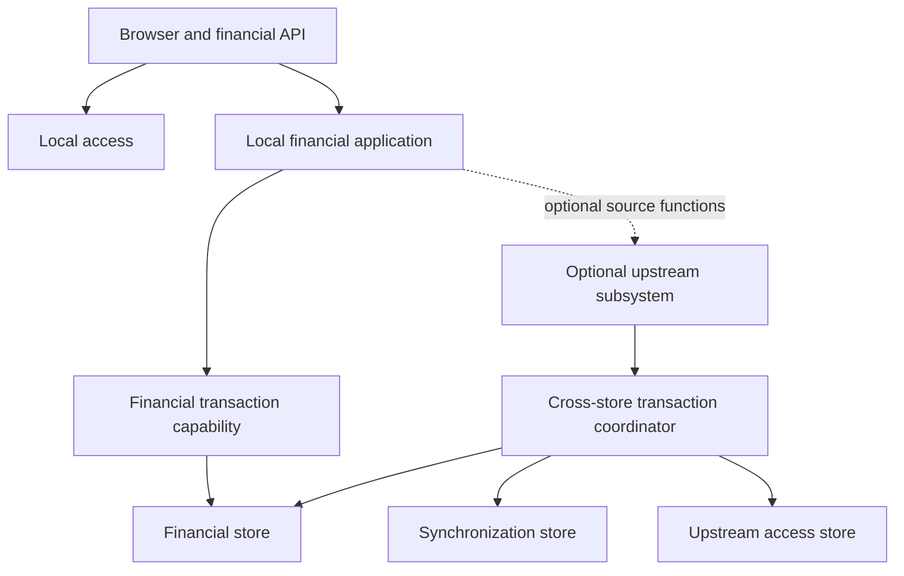

# Financial storage architecture and recovery

Wake is a single-user financial application with a durable, active **financial store**. A valid
financial store and local access store are sufficient for browser and financial API operation.
Separate synchronization machinery and upstream access from that core, while retaining SQLite
transactions for operations that must update multiple stores together.

This proposal combines application/persistence ownership, physical storage boundaries and recovery
into one design and one dependency-ordered implementation plan. Application owns financial policy
and use-case orchestration; persistence owns queries, durable writes and atomic execution. Neither
boundary should introduce optional upstream dependencies into local financial use.

## Status and non-negotiable requirements

Research date: 2026-11-15. Reviewed source revision: `12905959d02d81905736319fd699a84314160e02`.
The user selected the product framing, financial-store terminology and local-access requirement.
The detailed design below remains a proposal: it does not claim that the physical split,
transaction capabilities or recovery protocol are implemented. The [product
brief](../product/brief.md) owns product intent and [architecture
guide](../engineering/architecture.md) owns the implemented design.

- Wake is one single-user application. TCP endpoints are access mechanisms, not a shared-service
  architecture. Conventional data warehouse principles do not define the product.
- The financial store retains evidence, provenance, identities and attributable decisions alongside
  actively maintained accepted views. "Archive" suggests frozen data and is not the chosen term.
- Financial store plus local access is sufficient for browser login, financial pages, read-only API,
  conditional reads and SSE. Missing, stale or corrupt optional stores disable upstream functions,
  not local startup. Do not create placeholder optional stores to satisfy constructors.
- Retained-data browser corrections/releases, normalization and rebuilds also work independently of
  synchronization and upstream credentials. Financial receipts and rebuild checkpoints discover local
  work without requiring a durable synchronization queue.
- Immutable evidence, append-only decisions and mutable projections have different rules. Preserve
  exact financial meaning, stable resource identities, provenance and explainability through changes.
- Financial integrity, format and rebuild-validity checks still apply. A clean financial snapshot is
  independent; a file from an interrupted cross-store transaction may still require its original
  recovery participants. Absence of optional stores is not permission to ignore hot journals.
- Local financial transactions commit financial state and publication in the financial file alone.
  Upstream association and freshness checks never gate local access or local financial writes.

## Target responsibilities and dependencies

Code ownership and durable-state ownership are separate decisions. Ask which code decides
financial meaning, then ask what losing each stored record would mean. Loss of evidence, intent,
identity or explanation places a record in financial storage; loss of the next upstream step or
retry schedule places it in synchronization. Permission and credential lifecycles belong to access
control.

The diagram shows required versus optional dependencies, not Go imports or runtime processes.



Composition constructs local readers and command handlers without opening optional stores. Attach
optional databases only for an available upstream subsystem and its coordinated operations. Failed
optional initialization must not poison the financial connection or block local handlers. Keep one
ordinary financial writer and serialize cross-store operations through its owner.

### Code ownership

The governing distinction should be:

> Application decides what financial state should result and which changes belong together.
> SQLite determines how to read and persist that state atomically.

Moving orchestration into application does **not** require moving calculations outside
transactions. Application code can run inside a transaction owned by the SQLite adapter.

Keep the existing packages initially. There is enough room to improve the boundary without
introducing a new domain hierarchy or splitting the daemon.

| Current responsibility | Proposed owner | Concrete treatment |
| --- | --- | --- |
| Correction validation, expected-revision rules, prospective decisions, set/release semantics | Application | Extract the policy portions of `prepareCorrection`, `SaveDecision`, and calculation input preparation. |
| Choosing whether observations identify the same activity; ambiguity and contribution decisions | Application | Extract the algorithms from activity linking and contribution handling; keep indexed candidate retrieval in SQLite. |
| Instrument compatibility, identity-combination eligibility, underlier selection | Application | Extract decisions from identity/root processing into typed calculations. |
| Processing sequence: admit claims, calculate affected state, record completion | Application | Move the use-case sequence behind an application-owned processing service using one transaction scope. |
| History-update phases, progression, retry policy | Application | Move workflow decisions; keep durable cursors, batch queries, and format handling in SQLite. |
| Queries, joins, indexes, codecs, SQL row conversion | SQLite | Retain these, returning typed application inputs rather than `sqlc` rows. |
| Decision insertion, supersession relations, aliases, projection writes, receipts | SQLite | Persist explicit application results using transaction-bound methods. |
| Database opening, locks, migrations, backup, connection configuration | SQLite/daemon | Preserve existing ownership. |
| Dirty tracking, materialized publication, version advancement, commit, notification | SQLite initially | Preserve the atomic commit path; extract financial selection policy from it where necessary. |
| API and admin read queries | Existing read ports and SQLite | Keep direct query access through interfaces; avoid adding forwarding services without behavior. |

Several current functions mix both columns, so this should be a **function-level extraction**, not
wholesale file movement.

The instrument correction boundary separates [SQLite inputs](../../internal/persistence/sqlite/instrument_correction.go)
from [revision checks and prospective calculation](../../internal/application/instrument_correction.go).

Likewise, `combineIdentity` in [identity.go](../../internal/persistence/sqlite/identity.go)
compares instrument families, reference choices, and active operator decisions before modifying
aliases. Those comparisons are financial policy. Fetching candidates and applying the resulting
aliases are persistence responsibilities.

### Durable-state ownership

| Responsibility | Recommended home | Reason and boundary |
| --- | --- | --- |
| Original artifacts, qualified source claims, source corrections and their appearances | Financial | Irreplaceable evidence and interpretation provenance; retain original precision and source scope. |
| Acquisition receipts, requested/reported coverage, equivalence policy and digest | Financial | Explain what was acquired, when and why bytes were reused; retain even when no new financial event results. |
| Source descriptors and confirmed account source authority | Financial | History must remain attributable without current connection configuration. Historical financial authority does not grant current upstream permission. |
| Discovery evidence and candidate snapshots | Financial | Confirmation must remain explainable. Preserve the current evidence-retention rule; selecting the latest actionable candidates is a view, not a reason to delete older snapshots. |
| Financial IDs, aliases, accounts, instrument bindings, operator decisions and supersessions | Financial | Reconstructing these arbitrarily would lose intent or break consumers. |
| Accepted financial views, positions, explanations and publication identity/revisions | Financial | Preserve atomic financial changes and offline reads. No separate projection database in this proposal. |
| Search indexes, deduplication indexes, publication/positions dirty sets | Financial | Local derived machinery for the financial store. Reconstructability alone is not a reason to split a transaction. |
| Successful normalization/processing receipts and interpretation eligibility | Financial | Establish which retained interpretation exists and supports current results; commit with the claims or projection they acknowledge. |
| Financial format, applied rule, rebuild target/phase/cursor and validity gate | Financial | Necessary to detect and resume partially rebuilt financial state without serving mixed interpretations. Keep the in-place rebuild checkpoint with its writes. |
| Rebuild retry deadline and UI progress notifications | Synchronization/runtime | Execution timing can be recovered from the financial checkpoint. Completed-work counts may remain with that checkpoint when part of its atomic progress record. |
| Provider continuation, work revision, requested next step and routine poll deadline | Synchronization | Provider execution state, including opaque continuation payloads. Never reconstruct a cursor from financial event dates alone. |
| Pacing reservations, cooldowns and reference request budgets | Synchronization | Restart-safe limits on upstream activity; losing these is not permission to immediately retry. |
| Queued normalization, processing and enrichment work; retry deadlines and current failures | Synchronization | Rebuild work from retained evidence, receipts and rules. Pending queues are not the authority for what financial processing has completed. |
| Attempts and diagnostic status | Synchronization | Bounded operational history; retain successful interpretation provenance in financial receipts. Do not prune current attempts until the provenance split is verified. |
| Reference request/response evidence and accepted identity selections | Financial | Accepted identities must remain explainable after caches expire. |
| Reference cache entries, expiry and scheduled refresh times | Synchronization | Cache loss must not remove supporting evidence or change accepted reference selections. |
| Current non-secret connection settings, polling preferences and enabled acquisition inputs | Synchronization | Installation execution configuration, with revisions used to invalidate affected continuations. Include these user settings in operational backups. |
| Encrypted upstream credentials and reference API key | Upstream access | Secret lifecycle is independent of financial retention. Retain identity/AAD bindings; moving configuration must not orphan or misbind ciphertext. |
| Upstream resume authorization and reviewed store/configuration association | Access control | Persist an explicit grant tied to the relevant store identities/generations. Synchronization may impose pauses but cannot mint permission. Missing grants fail closed. |
| Browser password/session authority and consumer token verifiers | Local access | Installation authority, excluded from financial-only exports. Keep separate from upstream credentials and from scheduler reset. |
| Listener settings, file locations, runtime locks, logs and currency catalog cache | Configuration/runtime | Existing TOML/filesystem responsibilities; not every application byte needs a database. |

### Boundary details

Not all execution-looking metadata belongs in synchronization. Keep the in-place rebuild cursor
and validity marker with financial writes: loss of scheduling state cannot make a partial rebuild
look complete. Retry timing belongs to synchronization; financial consistency metadata stays
financial.

Access is not one file. The [upstream access
schema](../../internal/persistence/sqlite/connections_schema.sql) currently stores configurations,
encrypted credentials and reference settings. Browser and consumer authority live in
[auth.json](../../internal/clientaccess/store.go). Keep those distinct lifecycles. The proposed
physical layout is financial SQLite, synchronization SQLite, upstream-access SQLite, and the
existing private local-authentication file. These are roles, not final filenames or keys.

Current polling overrides are embedded in access settings; artifact rows contain processing retry
fields; instrument rows contain reference deadlines. Split these at field level. Current profile
metadata also mixes recovery pause and association. Ongoing pairing/grants belong outside
financial storage; financial integrity and consumer continuity metadata remain within it.

Reference cache entries can expire without deleting retained request/response evidence or accepted
selections. Successful processing receipts establish provenance and interpretation eligibility;
current attempts and retry diagnostics are operational. Verify provenance preservation before
pruning operational attempts. Derived search/deduplication indexes can stay with their financial
transactions.

Synchronization contains private account references and may contain sensitive provider
continuations. Keep private file permissions and secret-safe diagnostics, retain encrypted
credential handling, and review opaque provider state before defining its export/retention policy.

## Operations and transaction boundaries

Introduce narrowly scoped transaction callbacks owned by their application consumers. For
corrections, the interface would conceptually provide:

```text
ViewCorrection(context, callback with correction reader)
UpdateCorrection(context, callback with correction reader/writer)
```

The names are illustrative. The important properties are:

- The capability exposes typed financial inputs and explicit persistence operations.
- It contains no `sql.Tx`, `sqlc.Queries`, SQL strings, or generic `Exec`.
- The reader/writer is valid only during the callback.
- Application code cannot commit or open nested transactions.
- Every adapter method uses the same transaction-bound queries.
- Callback failure, finalization failure, or commit failure returns an error and prevents
  acknowledgement.

Use small correction-specific interfaces, with processing capabilities added when their use cases
move. Avoid a repository-wide transaction interface containing every operation.

The correction save path would become:

```text
SQLite begins write transaction
  Application checks submission idempotency
  Application reads current target, claims, bindings and decisions
  Application checks revision and identity
  Application prepares prospective decisions and calculates results
  SQLite persists decisions, supersessions and calculated projections
  Application coordinates any required identity effects
  SQLite persists those effects
SQLite finalizes published resources and positions
SQLite commits
SQLite notifies publication subscribers
```

The existing `commit` implementation in
[publishing.go](../../internal/persistence/sqlite/publishing.go) is the starting point for
finalization. Its ordering is valuable: derived publication is written before commit, and
notification follows successful commit.

Preserve these details explicitly:

- **Preflight is read-only.** It uses the same preparation/calculation code in a consistent read
  transaction. Saving rereads and revalidates inside its own write transaction; a successful preview
  is not a reservation.
- **Idempotency precedes fresh revision validation.** An identical already-accepted submission must
  retain the existing retry behavior even though the original save advanced the target revision.
- **No publication gaps.** Decisions, accepted state, explanations, versions, and affected positions
  retain their existing atomic grouping.
- **No network calls inside these callbacks.** Acquisition and reference HTTP work remain outside
  financial write transactions.
- **No whole-store input loading.** Use bounded or affected-group reads, preserving the current
  indexed access paths.
- **Root-processing phases remain distinct.** The current root logic intentionally discards cached
  inputs after binding writes. Moving it must preserve those reread boundaries.
- **History updates remain multiple resumable transactions.** Each batch's derived writes and cursor
  advance commit together. The existing availability gate prevents clients from treating an
  intermediate rebuild as a complete result.

Preserving guarantees does not mean turning the entire pipeline or a history rebuild into one
enormous transaction. Acquisition, normalization, financial processing, and rebuild batches
already have different durable boundaries. The relevant implementations include
[normalization](../../internal/persistence/sqlite/normalization.go), [root
calculation](../../internal/persistence/sqlite/root_calculation.go), [decision
saving](../../internal/persistence/sqlite/decisions.go), and [history
updating](../../internal/persistence/sqlite/history_update.go).

| Operation | Application responsibility | Persistence responsibility and atomic unit |
| --- | --- | --- |
| Accept a provider result | Host/application validates generation, configuration and authority | Sync revision/continuation/progress plus financial evidence, receipt and candidates when present. No HTTP inside the transaction. |
| Change settings or confirm an account | Application determines approved configuration and source authority | Current configuration/grant validation, required financial authority changes, and affected work invalidation/scheduling. |
| Reserve pacing or retry a job | Host/reference workflow applies admission and retry policy | Sync plus its access freshness witness; combine all affected budgets in one transaction. |
| Normalize retained evidence | Provider interprets claims; host defines attempt lifetime | Financial claims, provenance and successful receipt; queue acknowledgement can join or be repeat-safe. |
| Process claims or save a decision | Application calculates financial state and coordinates the use case | Financial inputs, decisions, accepted projections, explanations and publication; optional sync acknowledgement must not precede success. |
| Rebuild financial state | Application chooses rules and advances the rebuild workflow | Financial batch, phase/cursor and validity state together; sync may schedule the next batch. |
| Apply reference evidence | Reference/application selects financial identity and effects | Retained reference evidence and financial effects remain durable; cache updates may share the transaction without becoming financial authority. |

### SQLite execution constraints

Use the existing attached-writer model for upstream operations spanning files, with verified
DELETE journals and EXTRA synchronization on every participant. Do not enable WAL while relying on
atomic multi-file commits. Keep local financial paths independent of optional attachments. The
coordinator selects the required stores; providers receive no storage handles.

SQLite foreign keys cannot cross schema boundaries. Financial relationships remain internal;
validate sync-to-financial IDs and access associations explicitly in the shared transaction. See
[SQLite foreign-key
limits](https://www.sqlite.org/foreignkeys.html#limits_and_unsupported_features).

An evidence-first/checkpoint-second protocol would be necessary with independent commits, but is
not selected. It would need durable pending results, idempotency keys, configuration generations,
artifact-free-step handling and recovery before further acquisition. Two sequential writes are not
equivalent to the current guarantee. No such alternative protocol has been validated.

## Association and upstream admission

Use the following conceptual values; these are protocol roles, not final SQL column names.

| Value | Owner | Meaning |
| --- | --- | --- |
| Financial lineage ID | Financial | Stable identity of the retained financial history. Preserve it and resource IDs on restore. |
| Publication epoch | Financial | Consumer baseline incarnation. Rotate on every supported financial restore/import, including installation restore; preserve on restart and sync-only recovery. |
| Sync store ID | Synchronization | Fresh identity whenever sync state is recreated; not inferred from a path. |
| Sync safety token | Synchronization, mirrored in upstream access | Fresh random token on every safety-relevant sync or upstream-access change. Identifies exact safety state rather than merely the store's lineage. |
| Access store ID | Upstream access, bound in sync association | Identity of the encrypted upstream-access store. Replacement requires review; secrets retain their existing cryptographic identity bindings. |
| Association generation | Upstream access and synchronization | Fresh random value on recovery/rebinding. Binds the financial lineage/epoch, sync ID and access ID. |
| Resume grant | Upstream access | Actor, time, reviewed association and configuration/scope revision authorizing specific upstream work. Missing or stale grants deny acquisition and reference HTTP. |

Upstream access holds the expected sync safety token for its active association. Synchronization
holds the same association identifiers and its own safety token. The financial store holds no
scheduler cursor, upstream access grant, sync-store ID or externally mirrored financial head.
Association checks authorize upstream work only; local financial operation does not consult them.

Use unpredictable fresh tokens rather than counters alone: restoring a counter and advancing it
again must not recreate a previous state identity. Equality checks detect inconsistency, not which
copy is newest. Never select a winner by timestamp, file modification time, larger counter or
longest cursor. Tokens and checksums are consistency checks, not protection against a malicious
file editor.

### Transaction rules

- A local financial mutation commits financial state and publication in the financial file alone.
  An acquisition commit uses the attached transaction to retain evidence, advance sync safety state
  and update its upstream-access witness together.
- A safety-relevant sync mutation updates its token and the access witness atomically. This includes
  artifact-free steps, checkpoints, pacing reservations, cooldowns, settings, polling preferences,
  scheduled/enabled work, retry deadlines and recovery transitions.
- Credential replacement, upstream grant/revocation and reference-access changes also rotate the
  sync safety token and its witness. Restoring only old access state must not resurrect a grant.
- Cache payloads and diagnostic counters that cannot influence admission or skip required work need
  not advance tokens. If a field affects those decisions, classify it as safety state by default.
- Every upstream operation validates its association, grant and expected revision in its transaction;
  startup validation alone is insufficient. Validate current financial source authority as well as
  configuration scope; local authority changes must not require an upstream store to commit.
  An in-flight provider result from an obsolete generation cannot acknowledge progress. It must be
  rejected or explicitly retained as non-acknowledging evidence.
- No network operation holds a database transaction open. Reserve pacing and validate admission
  before the call; revalidate association/configuration on acceptance afterward.

Scheduler changes write sync plus a small access witness, but do not write the financial file or
materialize financial publication. There is an explicit additional write cost. It purchases
detection of a sync-only rollback, including a pacing-only change. Removing the witness would
remove that guarantee.

### Startup state machine

1. Acquire process and required financial/local-access ownership. Check financial formats and any
   pending restore/upgrade intent before starting ordinary writers. Do not create optional stores
   merely to open the local application.
2. Recover interrupted SQLite transactions only with their original participant files and journals
   intact. Missing participants in a hot cross-file transaction block that transaction's recovery;
   this is different from absent optional stores beside a clean financial snapshot. Preserve the set
   for diagnosis; use a verified clean financial backup if original recovery cannot complete.
3. Validate the financial store and local authentication, then make browser and API access available.
   Enforce financial rebuild-validity gates. Local financial writes do not wait for upstream setup.
4. Independently inspect optional sync/upstream-access state. Missing or invalid state leaves upstream
   work unavailable. If present, compare financial lineage/epoch, sync/access IDs, association
   generation and sync safety token. A mismatch requires upstream recovery, not local shutdown.
5. Admit upstream execution only with matching association, reviewed configuration/current financial
   source authority, usable credentials, valid resume grant and pacing eligibility. Never overwrite
   mismatched metadata merely to make it match.
6. An incomplete financial rebuild remains gated in every mode. Its local runner can resume from the
   financial checkpoint without creating or repairing optional stores.

Files must not be swapped beneath a running process. Supported replacement runs with Wake stopped
and ownership held. Local authentication remains required for exposed endpoints; lacking upstream
access does not make financial data publicly readable. Publication continuity comes from the
financial store and the supported restore protocol, not from availability of upstream witnesses.

### Provider restart and pacing policy

Recovery does not feed an empty continuation into existing acquisition and assume that is safe. An
adapter must support a bounded restart plan from reviewed configuration and retained coverage. The
plan identifies the source account, enabled streams, requested ranges, overlap/deduplication
behavior, known source limits, and the earliest permitted request time. Unsupported recovery
remains paused for that provider while local financial inspection and other independently ready
work proceed.

For IBKR, old outstanding report references and missing-window queues are not resumed blindly.
Request fresh reports for approved ranges. For SnapTrade, restart an approved scan with fresh
verification and fixed bounds rather than trusting an old offset. These requirements are derived
from [IBKR](../../providers/ibkrflex/acquire.go) and
[SnapTrade](../../providers/snaptrade/acquire.go) state; provider-specific restart adapters and
their upstream guarantees still require implementation proofs.

Pacing cannot be reconstructed from financial receipts because rejected requests and artifact-free
steps can consume budgets. Use the maximum of trusted surviving deadlines and a
provider-documented recovery bound measured from recovery time. If the provider offers no
defensible bound or a restriction may require upstream clearance, keep it paused until that
condition is resolved. Operator approval chooses scope; it does not waive provider restrictions.
There is no universal reset delay.

Authorization to restart is not evidence that history is complete. Show known coverage gaps and
unavailable source ranges independently of acquisition success. Repeated reports must preserve
receipts/provenance without duplicating financial activity.

## Backup, restore and recovery

Distinguish two backup products:

- **Financial backup/export:** a verified consistent financial snapshot, including provenance,
  decisions, views and unfinished-rebuild validity metadata. Exclude credentials, grants, scheduler
  state and live journals. Never present an incomplete rebuild as complete.
- **Installation recovery backup:** a coherent set of financial, synchronization, upstream-access and
  local-auth state plus configuration, with keys separately protected. Capture under stopped-store
  ownership after transaction recovery; independently timed file copies do not form a coherent set.
  Capturing local auth does not authorize reviving old grants on restore.

The [current upgrade backup](../../internal/persistence/sqlite/upgrade_backup.go) copies the
existing locked two-database set. Expanding it is implementation work; these products are not
advertised commands already available. Preserve original participants/journals until interrupted
SQLite recovery is complete; an arbitrary financial-file copy is not necessarily a standalone
recoverable snapshot.

### Lost synchronization store

After establishing that the financial file is clean, the operator chooses to rebuild
synchronization:

1. Preserve surviving files and validate the chosen financial store. Keep financial identities,
   evidence, decisions, public versions and unfinished-rebuild checkpoint unchanged.
2. Create a new sync ID and association generation. Rebind surviving upstream credentials only by
   their original connection/provider identity; do not rename identifiers to make decryption work.
3. Recover non-secret settings from a verified backup or operator input. Treat imported settings as
   proposals requiring review. Do not infer query IDs, enabled streams or polling preferences from
   financial source authority alone.
4. Reconstruct local processing work from financial artifacts, successful receipts, interpretation
   versions and the financial rebuild checkpoint. An old queue is never proof that work completed.
5. Clear provider continuations and upstream grants. Mark historical acquisition coverage as retained
   knowledge and synchronization resumability as unknown. Do not synthesize missing source history.
6. Persist the paused upstream association and token witnesses atomically. Local financial work
   remains independently available throughout recovery whenever financial validity permits.
7. Preview and authorize a bounded upstream recovery plan separately. Configuration or generation
   changes invalidate that preview. Successful authorization records actor/time and exact scope.

If the lost file participated in an unrecovered cross-file transaction, these steps cannot safely
start from the arbitrary remaining financial file. Recover the original set or restore a verified
clean financial snapshot first. Recreating an empty sync file is not transaction recovery.

### Older synchronization backup

An older sync copy with an outdated safety token is rejected even if its store ID and association
generation match. Keep the current financial store and access witness unchanged while diagnosing
it. Do not roll financial history back to accommodate the old scheduler, and do not rewrite the
access witness to endorse the old token.

Treat the old file as a recovery input, not executable state:

- Import only reviewed non-secret configuration. It may have lost later changes or re-enabled inputs
  the user disabled, so show enabled scopes and differences when current evidence is available.
- Discard its checkpoints, pagination offsets, outstanding request references, queued acknowledgements
  and resume grants. Rebuild with a new sync ID/generation using the lost-store procedure.
- Preserve any known future pacing restrictions from trusted surviving state as lower bounds. An old
  deadline is not evidence that a later cooldown did not exist.
- If the older file's safety token still matches, no recorded safety mutation distinguishes it from
  current state. It may differ only in disposable diagnostics/cache. Ordinary restart is safe under
  the classification rule; an explicit restore still follows recovery and requires resume review.

The same conservative treatment applies when sync/access are mismatched and it is unclear which is
old. Surviving tokens establish inconsistency, not chronology.

### Backup capture and manifest

A supported installation backup is taken with Wake stopped, its original transaction recovery
complete, and ownership locks held for the entire capture. The initial implementation need not
offer live coordinated backup. A financial-only export uses a clean consistent financial snapshot.

The manifest contains the backup ID, capture time, scope, supported formats, financial
lineage/epoch, sync/access IDs and association/token values when included, rebuild status, and
digests and sizes of each member. Paths are installation choices, not identities. Verify members,
format support, identity consistency and integrity before proposing a restore. A digest verifies
bytes against the manifest; it is not authentication of an untrusted archive. Keys remain
separately protected.

### Sync-only recovery

Keep the installed financial file and local auth. Use the lost/stale-sync procedure. Do not change
financial publication epochs or versions just because operational state was reset.

### Financial-only restore or import

Always rotate the publication epoch, even if the snapshot claims to be the most recent. Preserve
financial lineage, account/instrument/activity IDs, decisions, evidence and internal revision
history. Activate the financial store with existing or newly established local access. Reconstruct
local work without requiring optional stores. If upstream synchronization is later configured,
create a new sync ID/association and require reviewed settings/credentials and a new upstream
resume grant. Existing upstream associations no longer match the restored publication epoch and
cannot resume.

Every financial and positions version must incorporate the new epoch. Expose it through the
existing consumer baseline identity semantics (currently named `warehouse_id`) without requiring a
renamed wire field. Old ETags must not yield unchanged responses, and connected/reconnecting
clients must replace their mirrors rather than merge the restored history into a newer baseline.
Stable financial resource IDs and the consumer baseline identity therefore become explicitly
distinct concepts.

Restoring an older financial file can remove later decisions/evidence from the active view. The
preview must state this and preserve the replaced files; stable IDs do not make restoration a
merge. A move performed through import/restore follows the same rule. Ordinary restart at the same
intact installation preserves the epoch.

### Installation restore

Validate the complete backup set, then rotate publication epoch, sync ID and association
generation before activation. Treat backed-up continuations as diagnostic history, not resumable
execution; use the reviewed restart policy. Restore upstream ciphertext only with its compatible
key and original bindings. No backed-up resume grant authorizes work in the new association.

Keep current local auth when restoring in place. On a new installation, establish fresh browser
access and re-enroll API clients. Do not activate backed-up browser sessions, password authority
or client grants by default: an old backup may predate revocation. Auth material may be retained
as protected backup evidence, but this protocol provides no automatic grant-revival path.

### Interrupted restore

File replacement is not an atomic multi-file rename. Use a durable restore intent outside the
replaced files, binding the approved plan to source digests, original identities and prepared
target digests. Prepare and verify complete replacement files before touching installed ones;
fsync prepared files, intent and affected directories. Hold process/store locks throughout.

Preserve originals under recovery names and install prepared files using recorded phases. Every
startup checks the intent before opening ordinary writers or serving data. After interruption,
resume the same verified plan idempotently; if the expected files/digests are unavailable, remain
blocked. Never serve a mixed set or silently revert to whichever files happen to exist.

After all targets are installed, verify the association and integrity, persist activation
completion, and only then release the guard. Local access becomes available; upstream remains
paused. Keep original files until explicit cleanup under retention policy; failed restoration
never deletes the only recoverable financial copy. Extend existing upgrade/reset guards to cover
this lifecycle.

### Detection limits

A mirrored sync token requires a surviving current upstream witness. Restoring sync alone is
detected by upstream access; restoring upstream access alone is detected by sync changes recorded
with it. These checks never gate browser/API access. Consistently rolling back both witnesses can
be indistinguishable from a normal restart. This includes rolling back sync and access together
while the financial store has not changed, not just rolling back the entire installation.

Arbitrary manual replacement of the financial file with an old clean copy may be undetectable,
including when lineage and publication epoch match. There is no externally mirrored financial-head
witness. Supported restore/import always rotates the epoch before serving consumers. Losing
optional stores never forces an epoch change or disables API reads to compensate for this
detection limit. Local access is not a hidden financial freshness witness; its role is
authentication.

Wake deliberately does not add an external service, hardware monotonic counter or another local
"witness file" that backups could also roll back. Therefore it cannot claim universal rollback
detection or prevent a second machine from running a coherent clone. Supported restore always
creates fresh generations and requires review; manual wholesale file replacement and concurrent
cloned installations are outside that guarantee. A backup manifest alone does not solve this
limitation.

This is a consistency/recovery protocol, not anti-tamper protection. Checksums, equality tokens
and file permissions do not prove that a privileged host operator has not altered all copies.

## Technology decision and alternatives

The workload needs durable small records, revision checks, due-work lookup, multi-key pacing
changes, private local operation, and reliable coupling to retained evidence. No measured
throughput problem justifies introducing another engine. The recommendation is based on recovery
complexity and fit, not an unmeasured claim that one engine is faster.

| Option | Relevant capabilities and costs | Assessment for Wake |
| --- | --- | --- |
| Separate SQLite file, attached to the existing writer | Existing SQL/sqlc/driver/tooling; relational due-work queries; one transaction can span attached files under the required journal configuration. | Recommended. Separates contents while preserving important atomic operations. |
| Separate SQLite connections with independent commits | Same engine and query facilities, but separate transactions do not share atomicity. | Consider only if independent commit/recovery becomes a product requirement. Requires a handoff protocol. |
| bbolt | Embedded Go key/value database, one writer with concurrent readers, transactional updates and consistent backups. | Credible alternative for isolated state; Wake would own key encoding/index maintenance and a cross-engine recovery protocol. No demonstrated benefit here. |
| Badger | Embedded Go transactional key/value engine using an LSM tree and value log. Exposes compaction/GC and write-durability settings. | More machinery than this workload currently motivates; also requires cross-engine recovery. |
| Atomic JSON files or a custom journal | A small configuration document is straightforward; ordered work, multi-record changes, locking, crash recovery and compaction become application responsibilities. | Retain files for small existing configuration/auth responsibilities; do not build a synchronization database this way. |
| External database or queue service | Adds a separately operated service and another failure boundary. | Outside the needs established for this single-user standalone daemon. Not researched as a deployment target. |

Primary sources checked on 2026-11-15:

- [SQLite ATTACH](https://www.sqlite.org/lang_attach.html): multi-file transactions are atomic
  when the main database is file-backed and WAL is not used. This supports the recommended
  coupling; separate files alone do not provide separate transactions.
- [SQLite multi-file atomic commit](https://www.sqlite.org/atomiccommit.html#_multi_file_commit):
  describes per-file rollback journals and the super-journal. Its filesystem, locking and
  durable-flush assumptions remain relevant to deployment and recovery.
- [bbolt documentation](https://github.com/etcd-io/bbolt): single-writer transactions, read snapshots,
  buckets/cursors and backup facilities. Its transactions apply to its own database; treating a bbolt
  update plus a SQLite commit as one unit would require a Wake protocol.
- [Badger design](https://github.com/dgraph-io/badger#design) and
  [Badger API](https://pkg.go.dev/github.com/dgraph-io/badger/v4): the inspected API page reports
  v4.9.6; `WithSyncWrites` defaults false and `RunValueLogGC` manages value-log reclamation.
  This is a capability comparison, not a recommendation to adopt that version or its defaults.

## Dependency-ordered implementation plan

Recommended implementation model: **GPT-6.1 with high reasoning**, especially for financial
identity and recovery work. Each phase may contain several reviewable changes. Preserve behavior
at every step; the physical split must not land as usable before its required recovery paths
exist.

### Phase 1: Establish independent local composition and a financial transaction capability

**Prerequisite:** agree on the local-operation requirement and transaction invariants above.

Separate local readers/handlers from optional upstream initialization while retaining the current
physical layout. Extract activity correction orchestration as the first complete use case:
prospective decisions, revision policy and save/release sequencing move to application; loading,
codecs, writes and publication finalization stay in SQLite. Do not change instrument identity
behavior incidentally.

**Result:** local commands have a narrow transaction capability without upstream prerequisites;
composition can exercise financial/browser/API behavior with upstream services absent. Physical
separation is still pending. Assess whether the interface improves readability before extending
it.

**Verification:** preflight writes nothing; set/release share calculation; stale requests fail;
identical retries remain idempotent; failed writes leave decisions/projections/publication
unchanged; rollback sends no publication event. Use the existing [financial calculation
tests](../../internal/persistence/sqlite/financial_calculation_test.go), including its injected
derived-write failure, as a baseline. Exercise browser/API construction without providers.

### Phase 2: Establish transaction coordination and upstream association semantics

**Prerequisite:** Phase 1's independently usable financial capability and composition.

Distinguish financial finalization from operational commits. Introduce only the transaction-scoped
capabilities required for acquisition, settings, account confirmation and pacing. The coordinator
owns token/witness updates automatically with safety-relevant writes; callers must not remember a
separate manual token operation. Define admission against current financial authority and reviewed
configuration. Implement/test association generations, grants and mismatch handling before using
them as recovery guarantees. Keep policy code independent of SQL and file names.

**Result:** local operations commit financial-only; upstream operations have one atomic execution
boundary with explicit participants. A pacing update cannot accidentally invoke financial
publishing.

**Verification:** artifact-free steps and pacing-only changes advance freshness; failed writes
roll back witnesses; settings/confirmation races and obsolete in-flight results cannot acknowledge
a new association. Include relevant race tests. No new storage layout is required to validate the
contracts.

### Phase 3: Build the physical split with a local-only recovery milestone

**Prerequisite:** Phases 1–2 and a defined stopped-store installation/backup strategy.

Move non-secret execution configuration, continuations, pacing, retries and caches into
synchronization SQLite. Keep receipts, financial identities, accepted views, rebuild
cursor/validity and publication inside financial storage. Preserve upstream credentials and local
auth as distinct responsibilities. Add explicit cross-schema association checks and financial-only
reads/writes. Implement clean financial-only backup/import, fresh publication epochs and guarded
activation for the new layout.

Treat layout preparation and tooling as several coherent changes. Do not activate new-layout
upstream synchronization before Phase 4. Respect the existing pre-release recreation policy; no
silent compatibility migration or automatic deletion of unsupported stores. Current wire/config
names are separate compatibility decisions, not a global rename bundled with this work.

**Result:** a clean financial store plus local access runs the application; optional stores may be
absent, corrupt or stale. Financial-only restore produces a usable local application without
creating optional stores. Existing data is handled only through an explicit supported plan.

**Verification:** browser login/pages, API ETags/SSE, corrections and local rebuilds work with
only the required files. No optional files or upstream calls occur. Financial restore changes all
consumer baselines but preserves resource IDs. Inject failure around preparation and activation
boundaries.

### Phase 4: Complete synchronization recovery before enabling upstream work

**Prerequisite:** Phase 3's separated layout and financial-only restore, plus Phase 2's
coordinator.

Implement lost/stale sync recovery, reviewed configuration import, backup manifests, installation
restore, durable restore intent and startup guards. Add bounded provider restart capabilities and
pacing recovery; unsupported recovery stays paused per provider. Keep backed-up local grants
inactive and preserve current local auth on in-place restore. Only enable upstream work after
these paths pass.

**Result:** normal restart resumes only valid associations; supported restores/reset never
silently reuse old continuations or authority. Mixed sets cannot become active after interrupted
replacement.

**Verification:** run the recovery matrix below, process-death checks at replacement/commit
boundaries, provider acceptance tests and independent consumer acceptance for
restore/ETag/positions behavior. Verify original-file preservation, missing recovery participants
and rollback-detection limits.

### Phase 5: Extract instrument and retained-claim policy through the established capabilities

**Prerequisite:** the settled transaction capabilities and storage ownership from Phases 1–4.

Extract instrument correction and identity eligibility first, then retained-claim processing and
history-update orchestration. Keep source-rule decisions in application and transactional data
access in SQLite. Instrument extraction preserves deterministic ordering, family compatibility,
reference choices, anonymous underlier enrichment, alias flattening, self-reference behavior and
relinking.

Processing establishes source authority/eligibility, admits and associates claims, determines
affected groups, calculates accepted state and records completion. Reuse the extracted
calculators/identity operations. Keep normalization's separate durable transaction so processing
failures can retry without reacquisition. History workflow moves to application while financial
checkpoints remain atomic with their batches; local discovery/resumption must not acquire a
sync-store dependency.

**Result:** maintainers find financial decisions in application and storage mechanics in
persistence, without changing financial meaning or making recovery a second implementation of
reconciliation.

**Verification:** competing operator choices, incompatible families, underlier contributions,
self-reference, relinking and resulting positions; replay/idempotency; rollback of admission and
projections; restart/resume of rebuilds. Guard root-processing reread phases and affected-group
bounds.

### Checks and delivery throughout

Update the owning architecture/coverage guidance when implementation establishes behavior. Remove
superseded internal entry points as callers migrate. Enforce application independence from SQL and
SQLite implementations, pure calculation independence from I/O/runtime services, transport
separation from persistence, external production SQL, and no generated SQL types in transaction
capabilities.

Run focused functional/rollback checks through Mise, relevant race checks and `mise run
source:check` for each phase. Use provider and independent API-consumer acceptance at the
processing and recovery boundaries. Do not substitute interface mocks for real transaction/failure
proofs. Broader suites follow changed callers and integration boundaries. These are proposed
checks, not reported results.

## Evidence, verification and limits

This research used static code inspection and primary engine documentation. No application tests,
engine benchmarks, storage prototype, crash tests or power-loss experiments established the
proposed design. The reviewed code and dated sources support the decisions; the proofs below
remain required.

### Source observations

The [current writer](../../internal/persistence/sqlite/store.go) already owns attached SQLite
connections; [profile.sql](../../internal/persistence/sqlite/profile.sql) configures DELETE journals
and EXTRA synchronization. Startup checks store identities and associations. The
[current resume path](../../internal/persistence/sqlite/workflow.go) checks a recovery revision and
records actor/time, but identity equality alone does not detect an older copy of the same store.
These are implementation foundations, not evidence that the proposed freshness protocol exists.

The current [Accept](../../internal/persistence/sqlite/acquisition.go) transaction checks the work
revision, advances continuation state, retains evidence/receipt and records discovery candidates
before one commit. `SavePolling` and `Reconfigure` also couple settings and scheduling.
[Confirm](../../internal/persistence/sqlite/workflow.go) verifies the current configuration and
candidate, establishes account authority and schedules acquisition atomically.

Provider steps can return no artifact while advancing protocol state. An [IBKR
continuation](../../providers/ibkrflex/acquire.go) includes an outstanding report reference,
requested windows and missing-window retries. A [SnapTrade
continuation](../../providers/snaptrade/acquire.go) includes scan bounds, offset and verification
state. The [contract](../../provider/acquisition.go) bounds opaque state to 64 KiB. Therefore
"replay from the last retained report" is not a universal recovery algorithm.

[Normalization](../../internal/persistence/sqlite/normalization.go) commits claims and its
successful receipt together. [Financial
processing](../../internal/persistence/sqlite/acceptance.go) commits accepted state and processing
completion together. [Publication](../../internal/persistence/sqlite/publishing.go) materializes
financial changes before commit and notifies afterward. [History
updating](../../internal/persistence/sqlite/history_update.go) commits each batch with its
checkpoint and keeps affected reads gated until completion. Preserve these separate units of work;
do not combine acquisition HTTP, normalization and all financial reconciliation into one
transaction.

### Required recovery proofs

| Scenario | Expected proof |
| --- | --- |
| Restart after no changes | Association accepted; grant and provider pacing still enforced; publication unchanged. |
| Sync rollback after a pacing-only change | Token mismatch; no network request; no financial file write just to detect the mismatch. |
| Sync rollback after an artifact-free step | Rejected despite unchanged financial publication. |
| Access rollback after grant revocation or credential replacement | Sync token detects stale access; old grant cannot resume. |
| Manual financial rollback outside supported restore | Documented detection limit; no false claim that optional stores make local reads safe. |
| Failed attached write/commit | Store changes and mirrored tokens roll back together; no notification or acknowledgement of success. |
| Rebinding while acquisition is in flight | Old result cannot advance the new generation's checkpoint. |
| Only financial and local access stores present | Browser login, financial pages, API reads/ETags/SSE and local corrections work; no optional files created or upstream calls. |
| Optional stores stale, corrupt or inaccessible | Financial browser/API operation stays available; upstream recovery status is scoped to source functions. |
| Lost clean sync store | Local financial operation continues; reset is explicit; no upstream activity before reviewed authorization. |
| Lost participant with hot journals | Ordinary startup/reset refuses; originals preserved; verified clean restore remains available. |
| Old configuration disables/enables different scopes | Preview surfaces scope; grants bind the reviewed revision; stale preview fails. |
| Sync-only recovery | Financial IDs, publication epoch and versions remain unchanged. |
| Financial or full restore | Resource IDs survive; financial/positions ETags change; consumers replace baseline. |
| Missing sync during an incomplete rebuild | Rebuild validity gate persists; local processing resumes from financial checkpoint without re-association. |
| Death at each restore replacement/activation boundary | Startup guard prevents mixed-set reads/writes and repeats the same verified plan safely. |
| Old auth included in backup | Existing revoked clients remain revoked; new installation requires enrollment. |
| Coherent rollback of every relevant witness | Documented limitation reproduced; test must not falsely claim it is detectable. |

Use real SQLite failure/restart tests alongside application admission/stale-preview tests.
Process-death tests do not establish power-loss correctness; SQLite's documented filesystem and
flush assumptions still apply. Measure scheduler write volume and financial-reader latency before
claiming a performance benefit or selecting a different engine.

### Remaining implementation details

The ownership, local-operation requirement, engine choice and recovery policies are resolved for
this proposal. Concrete metadata/API shapes, restore phase encoding, provider restart adapters and
their upstream guarantees still require implementation and verification. These details must
preserve the stated admission and rollback-detection limits rather than weakening them silently.

The main refactoring risk is changing calculation order or its input snapshot, especially around
identity combination and rebuild batches. The main storage risk is exposing partial state or
reviving stale upstream authority. The success criterion is independently usable local financial
state plus repeat-safe, explicitly authorized upstream work, with the same financial explanation,
rollback, replay and publication guarantees.
